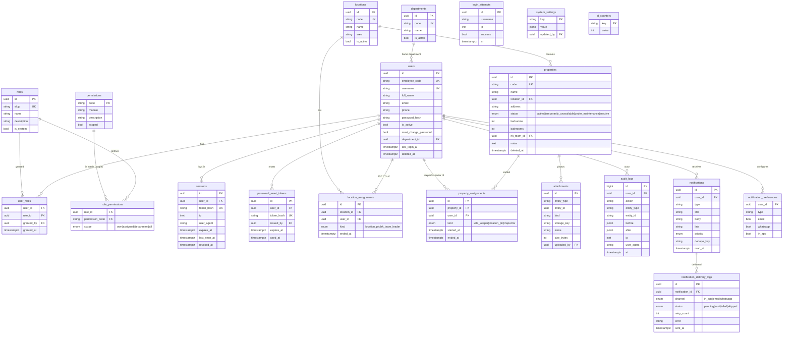
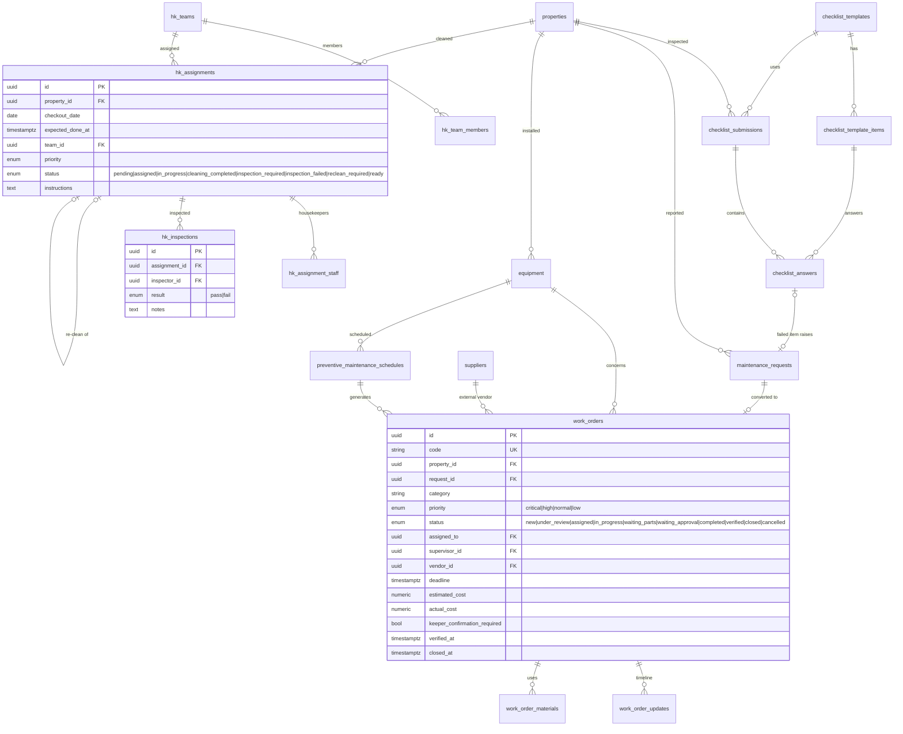
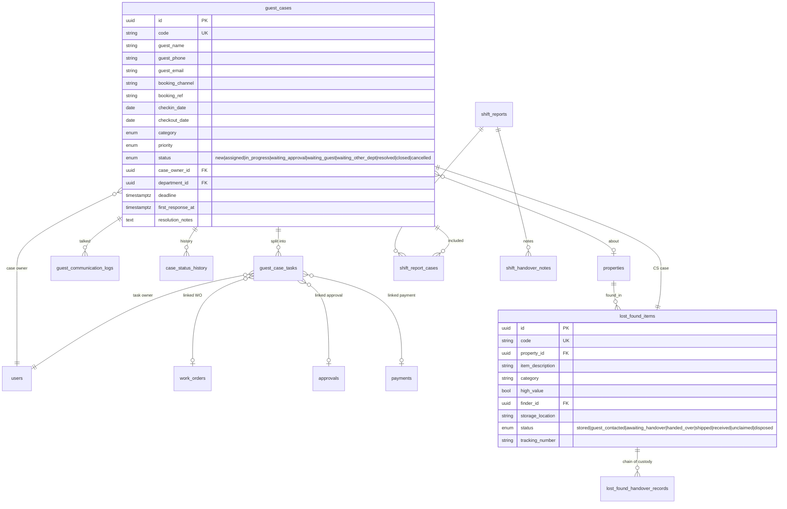
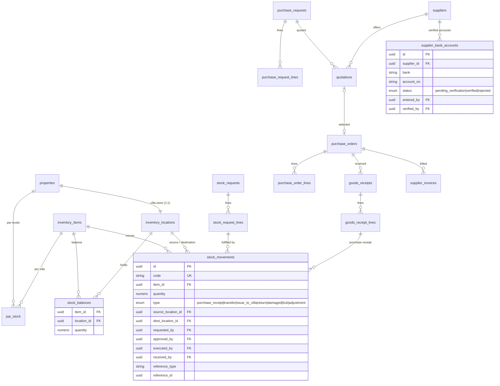
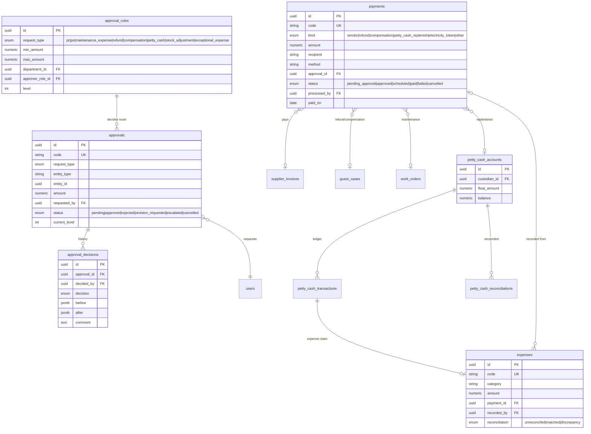

# COMS — Database Relationship Diagram

Legend: tables marked **[S1]** are implemented in Stage 1; others are the
planned design for later stages (may be refined, never silently dropped).
All tables have `id uuid PK`, `created_at`, `updated_at` unless noted.

## 1. Identity, RBAC, organization [S1]

## 2. Property operations, engineering, housekeeping [S2]

Villa readiness (`ready`) is set **only** by a passing `hk_inspections`
row — never by cleaning completion.

## 3. Customer service & Lost & Found [S3]

## 4. Inventory & purchasing [S4]

## 5. Finance, accounting, approvals [S5]

## Key constraints (enforced in DB and/or service layer)

* `CHECK (approved_by <> requested_by)` on approvals/stock movements/payments.
* Unique active assignment: one active `villa_keeper` per property
  (partial unique index `WHERE ended_at IS NULL`).
* `audit_logs` UPDATE/DELETE blocked by trigger.
* `stock_balances.quantity >= 0` unless an authorized exception movement.
